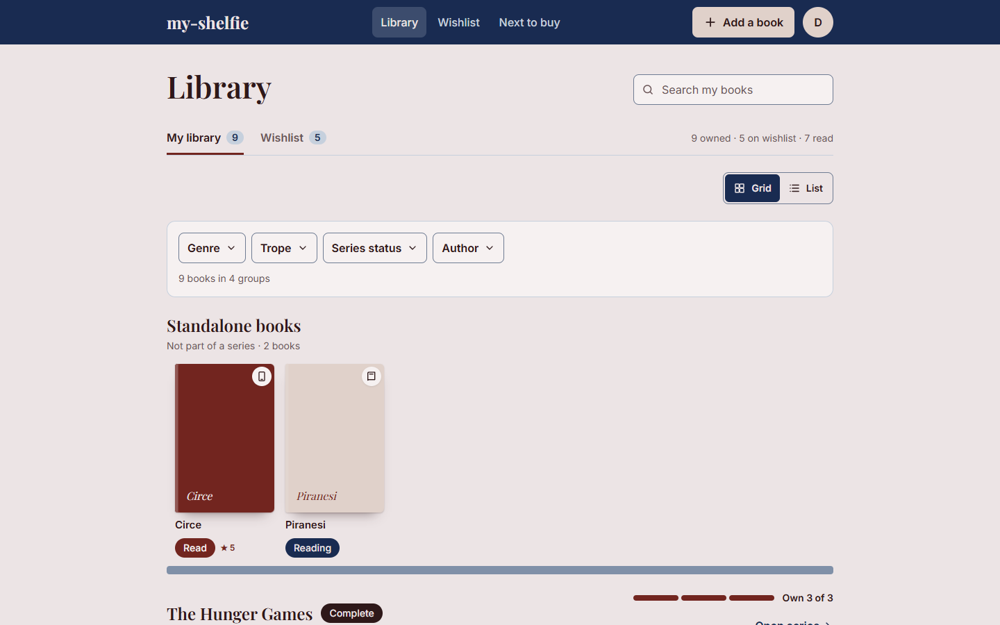
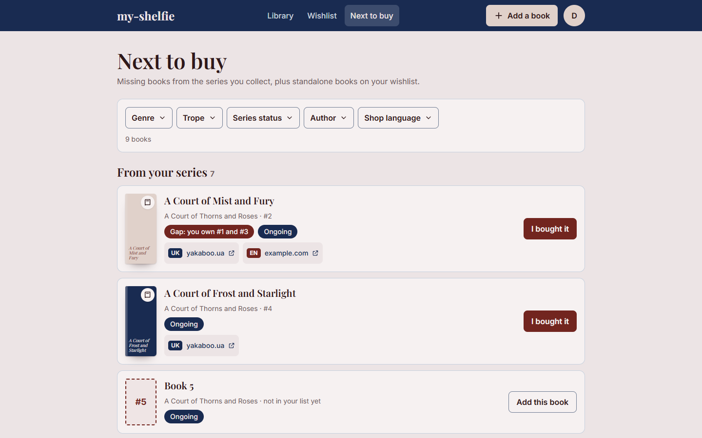
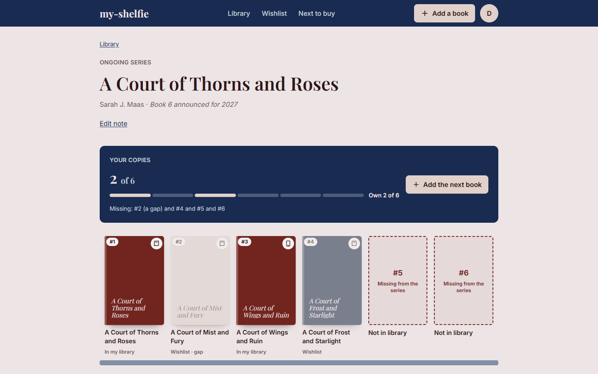
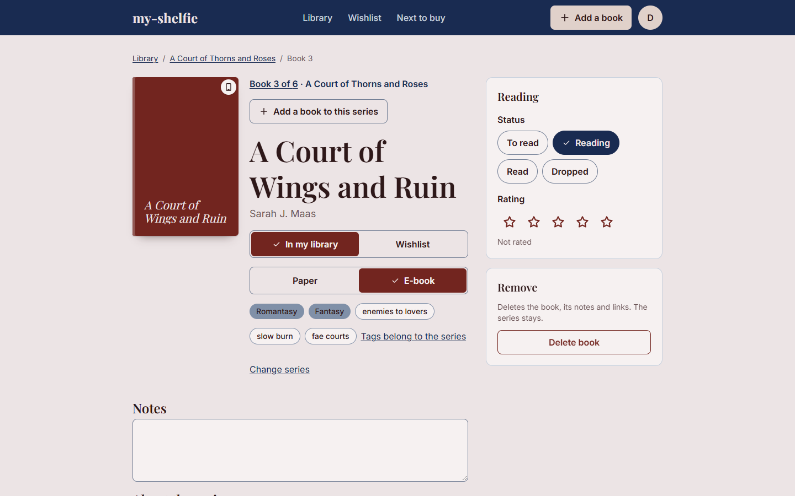
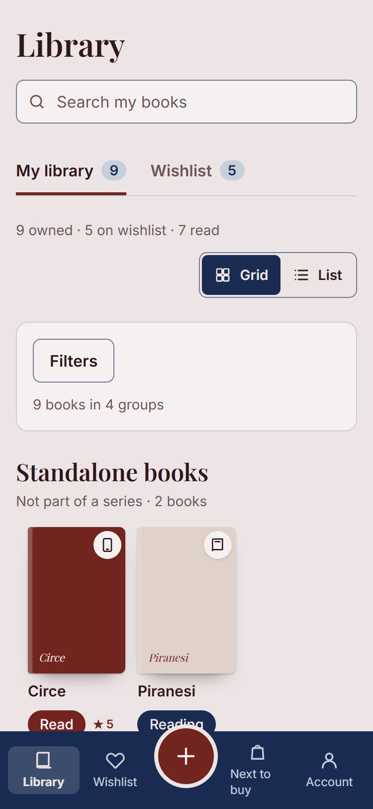
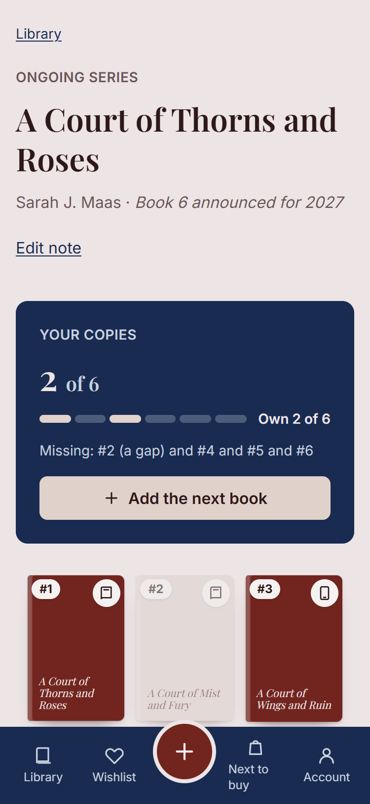

# my-shelfie

A catalogue of the books you own and a wishlist, organised by series. It replaces a Notion table:
you see at a glance which volumes of a series are on your shelf, which are missing, and where to
buy the next one.

**Live site:** <https://my-shelfie-ecru.vercel.app>

The backend runs on Render's free tier and sleeps after 15 minutes without traffic, so the first
request after a pause can take up to a minute.


## What it does

- **Library and wishlist.** Every book is either in your library or on your wishlist. Books are
  grouped by series with their number, as a cover grid or a list; standalone books come first,
  then the series with the most recently added book on top. A series has a status (still coming
  out, finished, unknown), an optional size ("6 books"), a note and one description, and it
  carries one set of genres and tropes for all its books.
- **Gaps.** A number below the highest one you own that you do not have is a gap, and it is marked
  on the shelf, on the series page and in Next to buy.
- **Paper or e-book.** Every cover carries a small mark for the format of that copy.
- **Adding a book.** Search by title (Google Books, filled in as you type) or add it by hand,
  then say which series it belongs to, its genres, tropes and shop links.
- **Filters.** Genre, trope, series status, author and shop language, on the library, the
  wishlist and Next to buy.
- **Reading.** A reading status (to read, reading, read, dropped), a rating from 1 to 5 and notes
  for each book.
- **Accounts.** Registration, login and logout; the session is a JWT in an `httpOnly` cookie.
  Every user sees only their own books.



### Next to buy

This is the one piece of logic that is more than a list. For every series of which you own at
least one book, it offers:

1. the wanted books **below your highest owned number**, the gaps, first;
2. then the other wanted books of the series in order, then the numbers of a series with a stated
   size that are not on your list at all ("Book 5, not in your list yet"), each with an
   **Add this book** action;
3. then the standalone books on your wishlist, newest first.

Each row shows the shop links you saved, marked RU, UK, EN or other, and **I bought it** moves
the book into your library. Filters narrow the list in the browser. A series you own nothing of
is not listed: you have not started it. The code is `server/services/nextToBuy.js`, and its
behaviour is pinned by tests.







On a phone the navigation is a tab bar and filters open as a sheet:

<p>
  
  
</p>

The screenshots show demo data with generated covers. Real covers come from Google Books and are
shown from their address, never stored.

## Stack

| Layer | Technologies |
|---|---|
| Frontend | Next.js (App Router), React, TypeScript, Tailwind CSS, SWR |
| Backend | Node.js, Express 5, Zod, bcrypt, jsonwebtoken |
| Database | MongoDB Atlas, Mongoose |
| Tests | Vitest and Testing Library (client), the built-in `node:test` runner (server) |
| Tooling | ESLint, Prettier, TypeScript type checking |
| Hosting | Vercel (frontend), Render (backend) |

## How it fits together

```
browser ──► Vercel (Next.js) ──/api/* rewrite──► Render (Express) ──► MongoDB Atlas
```

The browser only ever talks to the Vercel origin. Next.js proxies `/api/*` to the Express
service, so the session cookie is first-party: `vercel.app` and `onrender.com` are different
sites, and browsers such as Safari block third-party cookies by default. The backend is split
into controller, service and repository layers and answers with DTOs rather than raw database
documents. Every query is scoped to the signed-in user, and a book or series that belongs to
someone else answers `404`.

| Endpoint | Purpose |
|---|---|
| `POST /api/auth/register`, `POST /api/auth/login`, `POST /api/auth/logout` | Account and session |
| `GET /api/auth/me` | The signed-in user, or `null` |
| `POST /api/books`, `GET /api/books` | Create a book, list the user's books (filters, pagination) |
| `GET /api/books/search?q=` | Search the Google Books API (the key stays on the server) |
| `GET`, `PATCH`, `DELETE /api/books/:id` | Read, update or delete one book |
| `/api/series` | Series: create, list with owned and wanted counts, read with its books, update, delete |
| `GET /api/next-to-buy` | The next-to-buy list, with filters |
| `GET /api/tropes` | The user's own tropes, for suggestions |

Details: [docs/features/auth.md](docs/features/auth.md),
[docs/features/books.md](docs/features/books.md) and
[docs/features/series.md](docs/features/series.md).

## Why not Firebase

The course's reference projects use Firebase for authentication and data. This project is built
on its own Node.js, Express and MongoDB API instead, on purpose: it exists to practise the whole
stack, and Firebase would replace exactly the parts being practised — password hashing, token
sessions, request validation and the data layer. Authentication, books, series and Next to buy
are covered by tests, and the frontend is React with TypeScript, as the assignment requires.

## Design and specification

There is no separate mockup in a design tool: the design handoff is kept in
[docs/design/](docs/design/) (tokens, components, decisions and the HTML mockups at 375, 768 and
1440 px), and the screenshots above are the result. The specification is
[docs/ROADMAP.md](docs/ROADMAP.md) — the stages, the decisions taken and the alternatives
rejected. Each larger piece of work has a short design document in
[docs/designs/](docs/designs/).

## Run it locally

You need Node.js and a MongoDB Atlas cluster (the free tier is enough).

```bash
cd server
npm install
cp .env.example .env
npm run dev
```

Fill in `MONGODB_URI`, `JWT_SECRET`, `CLIENT_URL` and `GOOGLE_BOOKS_API_KEY` in `server/.env`
first. The backend listens on port 5000.

```bash
cd client
npm install
npm run dev
```

The frontend runs at <http://localhost:3000> and proxies `/api/*` to `http://localhost:5000`;
set `API_ORIGIN` in `client/.env.local` to point it elsewhere. Install dependencies inside
`client/` and `server/` only, never from the repository root.

Each package has one command that runs all of its checks:

```bash
npm run verify
```

In `client/` it runs ESLint, the TypeScript check, the Prettier check and the Vitest suite. In
`server/` it runs the Prettier check and the integration tests, which need Atlas reachable on
port 27017 and use a separate `-test` database. The full runbook, including deployment, is in
[docs/README.md](docs/README.md).

## What is next

An AI assistant that helps fill in a series' order, status and tropes, importing the Notion
table, and a dark theme. They are planned in the roadmap.
